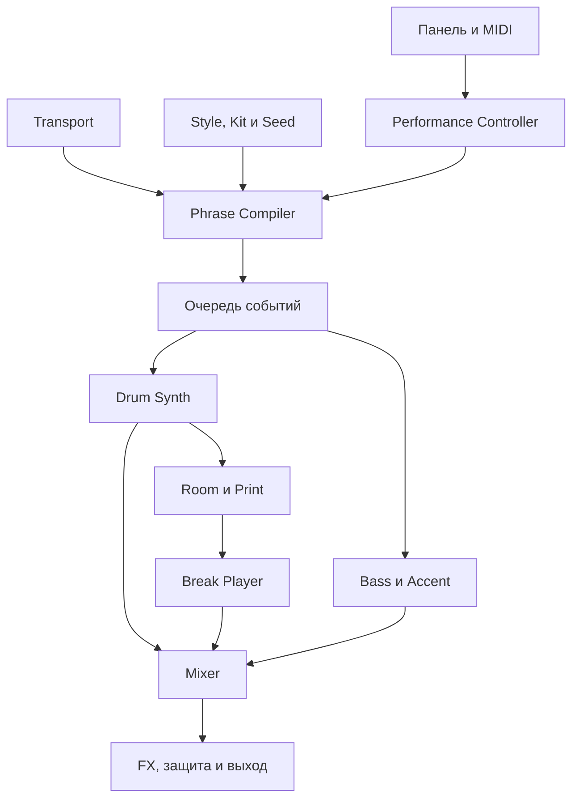

# BREAK//174 — архитектура DnB / Jungle / Liquid-инструмента для M-VAVE FM-1

Дата исследования: 16 октября 2026. Статус: проектная спецификация для обсуждения, без реализации и без прошивки устройства.

## 1. Замысел и границы

FM-1 должен становиться инструментом для игры брейками: PLAY запускает законченный ритмический фундамент; одно нажатие превращает его в Amen-style, shuffle, roll или переход; отпускание возвращает основной рисунок в правильную музыкальную позицию. Звуки барабанов синтезируются внутри устройства. Подготовка сэмплов на компьютере не нужна для первого запуска.

В запросе звук основного рисунка передан голосом/звукоподражанием. Здесь он трактуется как устойчивый повторяющийся грув с вызываемой вручную брейкбитовой вариацией. Это не точная транскрипция сыгранной партии. После архитектуры её можно уточнить по аудиопримеру.

Целевое устройство — M-VAVE FM-1, установленное по присланному каталогу. Приложенный NearTao PDF относится к Roland SP-404MKII, а не к FM-1, и не использован как источник характеристик железа. SP-404MKII рассматривается как внешний рекордер, сэмплер и исполнитель эффектов.

Три музыкальные задачи:

1. **DnB:** устойчивый rolling/2-step фундамент, мощный sub, короткие осмысленные fills.
2. **Jungle:** многотактовая структура брейка, перестановки фрагментов, смещения snare, ghost notes, kickbacks, dub-переходы.
3. **Liquid Funk:** подвижная, но менее перегруженная ритмика, мягкий ghost/shuffle-слой, чистый низ и место под гармонию.

Успех определяется тем, насколько инструмент можно сыграть руками. Количество паттернов, синтезаторов и экранов само по себе не является критерием успеха.

## 2. Что проверено и насколько полно

Сверены три источника обнаружения: The Firmware Hub, FW Radar и aroum/fm1-custom-fw; дополнительно выполнен поиск DnB/Jungle/breakbeat-ответвлений.

Живой JSON The Firmware Hub имеет отметку **2026-10-16 17:01 UTC** и содержит **52 записи**. Это число карточек каталога, а не число всех существующих прошивок. FW Radar в проверенном снимке перечисляет 60 проектов. Их охват отличается; часть записей — форки, экспериментальные ветки, коммерческие продукты или проекты для другого устройства.

Объединённый реестр ниже содержит 89 кандидатов после устранения двух дублей регистра GitHub URL. Получены и просмотрены README 83 репозиториев; это обзор назначения и заявленных функций, не аудит каждого исходного файла. Для некоторых форков README на main унаследован от родителя и не описывает собственную ветку. Важные для выбора основы ветки X0X-RMX и Acultur8 дополнительно прочитаны из фактического checkout HEAD. Шесть кандидатов не имеют полученного README либо доступны только внешней страницей. Vector37 по собственному README ориентирован на SMK-37 Pro и исключён из доноров FM-1.

На уровне выбранных исходных модулей разобраны X0X, Dinghy, Hortator, TRIBE и zp12; две дополнительные интеграционные ветки прочитаны на уровне документации и выборочных файлов:

| Проект | Проверенный checkout | Основная польза |
|---|---|---|
| X0X | `2e31c51` | `breaks.h/c`, sample-clock, ADPCM, слайсы, overload guard, HAL |
| Dinghy | `d44df7d` | контракт приложения, панель, USB, rescue, memory map |
| Hortator | `7e34159` | drum_core, ограничение голосов, choke, drum/performance-структура |
| TRIBE | `d95192b` | scatter-контракт и ограниченный кольцевой буфер |
| zp12 | `5319726` | sampling workflow, choke groups и окраска старого сэмплера |
| Acultur8 | `7bca4df` | собственная ветка и документация exact-marker / keep-pitch workflow |
| X0X-RMX | `7c40f5b` | собственная ветка Orb Remix и заявленный текущий статус |

На физическом FM-1 в этой работе ничего не запускалось. Числа CPU, полифонии и задержки ниже — требования и бюджеты проектирования, пока не указано обратное.

Полноту относительно закрытых, приватных и только что созданных репозиториев гарантировать нельзя. Ни рейтинг, ни наличие `.fwsc`, ни успешный WASM-эмулятор не доказывают стабильность на устройстве.

## 3. Главные доноры и ограничения

| Проект | Что полезно перенять | Чего нельзя автоматически заключать |
|---|---|---|
| [Dinghy](https://github.com/zvenson/dinghy) / [Felucca](https://github.com/hugelton/Felucca) | Подъём железа, клавиши, энкодеры, экран, USB MIDI/audio, updater и rescue | Минимальный шаблон не содержит нашего sequencer, многокилобайтного project store или break renderer |
| [X0X](https://github.com/charlesvestal/fm1-x0x) | Breakbeat-плеер, декодирование ADPCM, crossfade, музыкальные длины, измерение нагрузки | Текущие восемь равных слайсов не знают, где kick, snare или ghost; pitch связан с темпом |
| [Acultur8 X0X](https://github.com/keyboy250/fm1-x0x-acultur8) | Разделение физических границ слайса и музыкального onset; запуск без изменения скорости PCM | Это slice sequencing, а не полноценный timestretch; на медленном темпе появляются промежутки, на быстром — перекрытия; hardware qualification отсутствует |
| [X0X-RMX](https://github.com/Mr-Roboto/fm1-x0x-rmx) | Независимые вариации частей, Remix, Grids и Undo | В актуальном README Remix не перестраивает BREAK; Grids не заменяет жанровую модель Jungle |
| [Hortator](https://github.com/DeadActive/hortator) | Синтез барабанов, параметры моделей, choke, управление весом голосов, ducking | Восемь дорожек не равны восьми тяжёлым моделям одновременно без перегруза |
| [sloopDX](https://github.com/zvenson/dxsloop) | FM-барабаны, noise operator, параметры каждого удара, seed-based kit generation | Полный шестоператорный DX7 для каждого быстрого ghost-hit избыточен для первой версии |
| [TRIBE](https://github.com/apiel/fm1-tribe) | Эффекты на удерживаемых клавишах, работа на части или шине | Ring 16384 при 44.1 kHz — около 0.37 с, а не произвольная многотактовая память |
| [zp12](https://github.com/zvenson/zp12) | Rate pitching, 12-bit окраска, choke groups, channel thinking | Отказ от интерполяции — намеренная окраска; это не универсальный режим чистого звучания |
| [SLOOP](https://github.com/isod89/sloop-fm1) / [Skiff](https://github.com/illuminus5/skiff) | Live sequencing, microtiming, fills, условные триггеры и управление паттернами | Наличие набора Jungle не делает сам алгоритм перестановок жанровым |
| [Bubba Machine](https://github.com/Erbubar23/bubba-machine) | Процедурные звуки, live-сцены, разделение запрограммированного и сыгранного | Его большой workflow не нужно целиком переносить |
| [BEETLE](https://github.com/SikkenWorks/BEETLE) / [Ketch](https://github.com/risseraka/fm1-tracker-ketch) | Трекерная дисциплина retrigger, gate/cut и row commands | Трекер не должен становиться обязательным экраном для performance |
| [Baud Girl](https://baudgirl.com/work/FM-1+VA) / [Groove OS](https://www.groove-os.com/) | Референсы эргономики и исполнения | Это закрытые продукты, не доноры доступного исходного DSP |

В X0X фабричные break-лупы синтезированы его 909; оригинальные записи Amen/Think не входят в комплект. Следовательно, обещать «готовый оригинальный Amen из X0X» было бы ошибкой.

Каталоги отстают от исходников. Например, проверенный FW Radar описывает X0X-RMX как development; собственная ветка README уже заявляет v1.0.0 и успешный прогон на одном устройстве. В реестре такие статусы считаются заявлениями авторов, а не нашей проверкой.

## 4. Выбор архитектурного подхода

### Вариант A — узкий форк X0X

Убрать лишние машины, заменить дефолтный контент и переписать performance вокруг BREAK. Самый короткий путь к слышимому proof of concept. Минус: легко сохранить чужую логику пяти машин, восьми равных слайсов и несовместимые с целью интерфейсные решения.

### Вариант B — отдельный жанровый движок на платформе Dinghy/Felucca — выбран

Сохранить проверяемый аппаратный слой и обновление; создать собственную модель событий, drum renderer и performance controller. Из X0X, Hortator, TRIBE и других переносить отдельные ограниченные модули вместе с тестами и лицензиями. Существующие platform-fixes сравнивать по конкретным коммитам.

Преимущество: ритм, синтез, нарезка и интерфейс имеют один контракт. Нет необходимости стыковать пять независимых project formats, transport-моделей и систем эффектов.

### Вариант C — всё с нуля, включая HAL и updater

Максимальная свобода, но большая часть работы не приближает к музыкальному результату. Для этой задачи не выбран.

**Решение:** минимальная аппаратная платформа семейства Felucca, отдельный BREAK//174 core. Перед первым target-билдом фиксируется одна согласованная версия HAL/toolchain. Полное слияние нескольких прошивок не планируется.

## 5. Музыкальная модель: не randomizer, а редактируемый барабанщик

Жанровой основой служат не только позиции бочки и малого. Важны связь сильных и тихих ударов, непрерывное движение тарелки, длина хвостов, паузы, акцент первого удара фразы и возвращение после сбивки.

Интервью Paradox на Ableton описывает именно такие приёмы: отбор брейков под быстрый темп, разный уровень kick, отдельные hat/snare shuffles, kickback и сохранение воздуха исходной записи. Это музыкальное основание проектирования; предлагаемые ниже алгоритмы — наша инженерная интерпретация, не опубликованный алгоритм Paradox.

### 5.1 Три style profiles

Числа — предлагаемые значения по умолчанию, а не универсальные границы жанров.

| Профиль | BPM default | Основа | Поведение вариаций |
|---|---:|---|---|
| DNB | 174 | 2-step, rolling hats, короткий kick, читаемый snare | Сохраняет backbeat, меняет kick-ответы и ghost/shuffle, активнее в конце 4/8 тактов |
| JUNGLE | 166 | 2–4-тактовая break-phrase, ride, синкопы | Сдвигает опоры по заданной маске, переставляет подфразы, даёт kickback, occasional reverse и дроби |
| LIQUID | 172 | Мягкий roller, короткие ghosts, ровный низ | Реже вмешивается, ограничивает roll-density и distortion, оставляет пространство для баса и гармонии |

Не следует делать Liquid «Jungle с reverb». Отличаются плотность, артикуляция, сочетание kick/sub и отношение к тишине. Jungle также не сводится к максимально частым snares.

### 5.2 Ритмические семьи первой версии

- **AMEN-STYLE:** оригинальные синтезированные вариации с ride-пульсом, ghost-snare и характерными смещениями во фразе. Полная фраза хранится как события на четыре такта; один PCM-буфер не обязан содержать все четыре.
- **THINK-STYLE:** более сухой snare, tambourine/shaker, пружинистый shuffle. Исторические вокальные возгласы не синтезируются автоматически вместе с этим названием.
- **FUNKY / GHOST:** плотная, но тихая ghost-работа вокруг backbeat.
- **APACHE-STYLE:** tom/conga-ответы и перкуссионное движение.
- **TWO-STEP / ROLLER:** чистый современный базовый рисунок.
- **HALFTIME:** редкие опоры при прежнем глобальном BPM; это не перевод всего transport на половинную скорость.

Для первой слышимой сборки достаточно AMEN-STYLE и TWO-STEP. Остальные семьи добавляются после музыкальной проверки, а не создаются как номинальные названия пресетов.

### 5.3 Почему синтезированный Amen не равен исходной записи

В записи слышны drum kit, помещение, взаимопроникновение микрофонов, тарелки под snare, магнитный/дисковый тракт и история последующего сэмплирования. Раздельный kick + noise snare повторяет часть рисунка, но не всю фактуру.

Поэтому проект имеет два уровня:

1. Полностью автономный SYNTH: все источники рассчитываются алгоритмически.
2. SYNTH → ROOM → короткий внутренний print → CHOP: собственный синтезированный барабанщик превращается в непрерывную запись, а затем нарезается. Это основной путь к убедительной связности Jungle.

Импорт пользовательского WAV остаётся необязательным расширением. Оригинальная коммерческая запись не требуется для работы прибора. Названия `AMEN-STYLE` и `THINK-STYLE` обозначают характер ритма/обработки, а не наличие оригинального мастер-сэмпла или обещание точной копии.

## 6. Модули и направление данных

Mixer выбирает SYNTH либо PRINT для одной и той же основной drum-партии. Два ребра на схеме не означают постоянное суммирование дублей. Одновременное layering включается явно и ограничивается по уровню/фазе.

| Модуль | Ответственность | Основной контракт |
|---|---|---|
| Platform | Периферия, аудиоколбэк, USB, updater, rescue | Входные события, monotonic counter, render block |
| Transport | BPM, sample position, bar/phrase, external clock | Не останавливается из-за fill, reverse или выбора экрана |
| Style Library | Авторские фразы, роль ударов, правила развития | Не содержит DSP и обращений к железу |
| Phrase Compiler | Собирает следующую фразу из стиля, seed и жестов | Публикует целостный event buffer заранее |
| Drum Synth | Генерирует звук по событиям и параметрам kit | Не знает сцен и смысла кнопок |
| Print Renderer | Печатает drum-only bar в RAM с сохранением onset-метаданных | Два банка READY/BUILDING; активный не перезаписывается |
| Break Player | PCM-slices, reverse, rate pitch, tails/crossfade | Использует transport, не меняет master-clock |
| Performance Controller | Momentary/latch, quantization, приоритеты, Return | Временные жесты отделены от сохранённого проекта |
| Bass Engine | Mono sub + опциональный ограниченный mid | Одна согласованная басовая линия, mono-low |
| Mixer/FX | Уровни, окраска, throws, duck, limiter | Низ и master transport не разрушаются drum FX |
| Project Store | Версионированные настройки, patterns, seed, gestures | Запись flash только в разрешённой тихой фазе |
| Host/WASM | Рендер того же core для проверки/предпросмотра | Не является отдельной JS-имитацией инструмента |

## 7. Модель событий и паттернов

Шаговый экран — представление, а не предел временной модели. Внутри используются события с музыкальной позицией и скомпилированным sample-offset.

Поля `HitEvent`:

| Поле | Смысл |
|---|---|
| `position` | Музыкальная позиция внутри фразы, fixed-point tick |
| `role` | KICK, SNARE_MAIN, SNARE_GHOST, HAT_C, HAT_O, RIDE, TOM, PERC, AIR |
| `articulation` | Center / rim / ghost / flam / choke / buzz |
| `velocity` | Сила удара; управляет также яркостью и долей шума |
| `duration` | Gate либо доступная длина slice-tail |
| `micro_offset` | Направленный сдвиг с границами допустимого окна |
| `patch_or_slice` | Идентификатор модели/артикуляции или PCM-слайса |
| `locks` | Ограниченный набор изменений pitch/decay/filter на событие |
| `flags` | Anchor, fill-only, choke group, phrase ending |

Проектные ограничения v1:

- До 4 тактов в основной drum-phrase, 16 видимых шестнадцатых на странице.
- До 512 событий на фразу, включая развёрнутые rolls; compile-time cap, а не динамический рост.
- Восемь scene slots; scene ссылается на recipe/seed/kit, а не хранит множество копий PCM.
- 16 подготовленных fill recipes; любое количество воспроизводимых seed-вариантов внутри ограничений.
- 4-take RAM undo для музыкальных данных; PCM восстанавливается из recipe, а не дублируется на каждый undo.
- Ёмкость сохранённых проектов определяется реальным flash layout. Цель — 4 компактных проекта, не обещание до linker/storage-проверки.

Генерация использует PRNG с отдельными потоками для pattern, kit и humanization. Отрисовка, порядок MIDI-сообщений и число callback не расходуют музыкальный random-state. Один и тот же сохранённый seed воспроизводит тот же музыкальный результат.

## 8. Как работает Phrase Compiler

Порядок обработки:

1. Взять авторский skeleton выбранной семьи и позиции в 4/8/16-тактовом цикле.
2. Применить разрешённую для стиля anchor-mask.
3. Выбрать небольшие целые подфразы: pickup, shuffle, kick/snare response, ending.
4. Добавить тихие ghosts с согласованными velocity и timbre.
5. Развернуть активный live-жест: roll, kickback, exchange, stop или fill.
6. Добавить направленное humanization; сильные доли не дрейфуют вместе со всем рисунком.
7. Проверить столкновения, choke и минимальные интервалы.
8. Уложить events в лимит; при перегрузе убрать украшения в фиксированном порядке.
9. Подготовить sample-offsets и опубликовать следующий неизменяемый буфер на границе.

### 8.1 Иерархия правил

**Anchor.** В DnB основная snare-опора сохраняется по умолчанию. В Jungle отдельный рецепт может сознательно переместить или заменить её; такой сдвиг имеет точное место и возврат, а не возникает случайно в любой доле.

**Density.** Считает занятость временных окон и артикуляцию. На высоком BPM автоматически сокращается длина ghost/tail и ограничивается число близких ударов. Максимум Complexity не означает максимум Note Count.

**Phrase.** Первый такт устанавливает грув, следующие отвечают, конец 4/8 тактов допускает более явную сбивку. Можно отключить автоматические fills и играть только вручную.

**Human.** Отдельный профиль на hats, ghosts и mains. Стартовый диапазон edits: mains около ±0–2 мс, ghosts/hats до ±3–7 мс; это настройки продукта для прослушивания, не закон жанра. Сдвиги коррелированы внутри фигуры и ограничены соседними событиями.

**Velocity.** Ghosts тише и темнее, а не просто такая же snare на меньшем master-level. Короткие группы имеют форму crescendo/decrescendo. Каждый новый круг не перерисовывает весь рисунок случайно.

**Bass interaction.** Kick duck сокращает или прижимает sub на заданное окно. Перестановка snares не переставляет автоматически всю басовую линию. Root и басовый рисунок могут быть зафиксированы независимо.

### 8.2 Операторы исполнения

| Оператор | Музыкальное действие | Правило возврата |
|---|---|---|
| Roll | Повтор артикуляции в 1/16, 1/32, 1/64 | Возврат на ближайшую выбранную границу, master phase неизменна |
| Ghost Rush | Ускоряющаяся ghost-фигура | Основной snare сохраняется, если recipe не задаёт иное |
| Kickback | Kick + hat + освобождённое место | Подчёркивает новый downbeat |
| Exchange | Меняет местами совместимые подфразы | Сохраняет длину такта и функцию конца фразы |
| Displace | Сдвигает выбранный snare-ответ | Только по style-mask, с гарантированным выходом |
| Reverse | Разворачивает PCM-фрагмент | Только PRINT/USER, не притворяется реверсом синтеза |
| Half | Временный half-rate playback выбранного break | Master BPM и позиция других частей сохраняются |
| Stop | Короткий gate/tape-stop выбранной drum-шины | Следующая доля остаётся в сетке |
| Fill | Одноразовая фраза заданной длины | Автовозврат без второго нажатия |

В SYNTH-режиме Reverse недоступен до готовности print-buffer: клавиша показывает `PRINT NEEDED`, а не включает другой эффект под тем же названием. Rate-half в SYNTH можно реализовать отдельным ритмическим жестом, явно помеченным `HALF RHYTHM`; он не обещает аудио-pitchdown.

## 9. Drum Synthesis: единый kit с разными артикуляциями

Планируется компактный percussion DSP, а не полная акустическая симуляция. Точные частоты и времена ниже — стартовые диапазоны для настройки на слух.

### Kick

- Основной sine/triangle-резонатор с быстрым экспоненциальным pitch-drop.
- Tail примерно 45–90 Hz в зависимости от kit; attack pitch значительно выше на первые 5–25 мс.
- Отдельный короткий band-limited click/noise.
- Decay 60–220 мс для быстрых DnB-kit; длинная 808-sub-партия задаётся отдельно.
- Velocity одновременно меняет click, pitch sweep и громкость.

### Snare

- 2–3 затухающих моды корпуса, ориентировочно 150–450 Hz, не обязанные быть строго гармоническими.
- Band-pass noise для wire/body, отдельный high-pass noise для crack.
- Ghost — мягкая атака, меньше высокочастотного шума, короче хвост; main — другой баланс составляющих.
- Rimshot смешивает короткий inharmonic metallic-компонент; flam — два события с согласованной динамикой, а не один размазанный attack.
- Общий шумовой/room-след связывает соседние удары.

### Hats / Ride

- Несколько высокочастотных негармонических генераторов и noise, затем HP/BP-фильтрация.
- Closed/open используют общую choke group; закрытие даёт короткую release-ramp.
- Ride имеет отдельную длительную metallic-tail; сокращение её при высокой плотности приоритетнее удаления main-snare.
- Примитивная square-bank без контроля спектра алиасит. В CLEAN используются ограниченные/предфильтрованные источники; намеренный foldback допускается только в GRIT-режиме.

### Toms / Percussion / Air

- Toms — 2–3 затухающих резонатора + transient и небольшой pitch-sweep.
- Rim/wood/conga — фильтрованный импульс и ограниченное число резонаторов.
- Air — тихий согласованный room/noise-компонент, реагирующий на удары; не обязательная постоянная шумовая дорожка.

### Голосовой бюджет

Восемь типов/ролей барабанов не означают восемь одновременно работающих тяжёлых моделей. Цель v1 — не более 6 активных drum voices, включая tails, плюс mono bass. Важные kick/snare имеют приоритет перед ghost, а те — перед длинным ride-tail. Choke и завершение голоса проходят с de-click ramp. Предельная плотность events ограничивается отдельно от полифонии.

## 10. Внутренняя запись и семантическая нарезка

### 10.1 Почему это лучше равного деления на восемь частей

У синтезированного брейка известны моменты и роли всех ударов. Не нужен дорогостоящий real-time transient detector, чтобы повторно найти то, что сам движок только что сыграл.

Для каждого slice хранятся:

- Audio start/end и доступный хвост.
- Musical onset и длительность фрагмента в долях.
- Role-mask: kick/snare/ride/ghost/compound.
- Принадлежность подфразе, anchor и уровень RMS/peak.
- Разрешённые переходы и safe crossfade window.

Слайс может содержать snare вместе с ride и room. Этот compound slice нужен для связности, хотя MIDI-события исходно разделены.

### 10.2 Два банка

- **A:** активный готовый print.
- **B:** следующий print или короткий capture-ring, когда перестроение не идёт.
- Состояния: EMPTY → BUILDING → READY → ACTIVE.
- Swap только после READY на музыкальной границе.
- Смена kit/seed не повреждает играющий A.
- На первом запуске уже играет SYNTH, пока нужный print готовится.

Печать выполняется ограниченными порциями в свободное CPU-время на отдельном состоянии drum-synth; она не продвигает осцилляторы живого drum-synth. Если свободного бюджета нет, print откладывается. Самый простой fallback — построение на STOP. Мгновенная смена любого kit с немедленным готовым print не обещается.

### 10.3 Темп, pitch и реальные ограничения

1. **SYNTH:** темп задаёт onsets, тембр барабана независим от BPM.
2. **SLICE / KEEP PITCH:** onsets слайсов следуют transport, PCM играет со своей скоростью. Пустоты и overlap контролируются gate/tails и выбором фрагментов; это не «идеальный timestretch».
3. **RATE:** скорость чтения PCM меняется вместе с высотой. Подходит для характерного old-school pitch-up/down.
4. **JUNGLE STRETCH:** отдельный будущий granular/repeat-эффект с намеренными артефактами. Не обязательное средство удержания темпа и не обещание CPU до профилирования.

Crossfade 0.5–2 мс на переходах подбирается по transient; постоянные 2 мс на каждом snare могут смягчать атаку. Фрагменты с выраженным transient используют короткий fade-out предыдущего хвоста и минимальный fade-in новой атаки.

Реверс требует сохранённого аудио. Для встроенного SYNTH PRINT можно сразу хранить PCM; ADPCM для пользовательского контента экономит flash, но добавляет checkpoint/decode-нагрузку и усложняет случайный reverse.

## 11. Фактура и эффекты

### 11.1 Pre-print и post-chop — разная музыка

**Pre-print:** Drum Synth → shared room/bleed → мягкая bus saturation/компрессия → print. Тогда при нарезке режутся уже общие хвосты, как в записи брейка.

**Post-chop:** slice edits → transient control/EQ → optional grit → send FX. Это окрашивает результат перестановки, не стирая исходный общий след.

### 11.2 Предлагаемая цепь

Drum source → HP/DC removal → короткий body-EQ → saturation/parallel comp → optional CRUNCH → drum-performance FX → mixer.

Bass → DC removal → mono-low / optional mid distortion → kick-duck → mixer.

Mixer → filtered delay/reverb returns → мягкий safety clip/limiter → MASTER → USB/DAC.

### 11.3 Макрос CRUNCH

Не просто bit depth. Он согласованно управляет input drive, effective sample rate, квантованием, output LP и выравниванием уровня. CLEAN сохраняет интерполяцию и anti-alias filtering. OLD специально допускает спектральные отражения/ступенчатость. Dither уменьшает коррелированные искажения квантования, но не устраняет aliasing.

Saturation создаёт гармоники и уплотняет тело, но при чрезмерном drive съедает crest factor и snare-transient. Поэтому amount связывается с компенсацией output-level и пределами по peak, а не просто делает звук громче.

### 11.4 Пространство

Room — короткий общий след, shared FDN/comb-подобная бюджетная реализация; stereo widening только в верхах/FX-returns. Sub остаётся mono. Длинная reverb не является обязательным компонентом drum-path.

Dub delay получает snare/perc/stab по send. Throw на один удар оставляет хвост после отпускания; отпускание прекращает новый send, а не обрубает delay-buffer. Feedback ограничен и фильтрован; hold не должен вести к неограниченному росту.

Не все эффекты работают одновременно. CLEAN, OLD и HEAVY — бюджетные конфигурации. При перегрузе первым сокращается décor/space, затем длинные tails; transport, kick, main-snare и sub имеют защищённый приоритет.

## 12. Бас и Liquid-слой

Одна логическая bass-партия:

- **SUB:** sine с опциональной небольшой triangle-компонентой, mono, controlled glide.
- **REESE MID:** две слегка detuned band-limited saw/lookup-формы, HP перед суммированием с SUB; отдельный уровень.
- **808:** pitch-envelope и длинный decay при явном выборе; kick и 808-tail не складываются бесконтрольно.
- **RAGGA / DUB:** короткие root/fifth/октавные ответы, не автоматическая бесконечная гамма.

Mid и sub не обязаны иметь одинаковую мгновенную фазу: detuning в mid намеренный. Низ mid ослаблен, а sub не стереорасширяется. Каждый note-on имеет определённую политику phase reset/legato, чтобы не получать случайные провалы при layering.

Для Liquid достаточно опционального accent-пути: один FM/e-piano/filtered-stab слой с ограниченной полифонией. Полный аккордовый workstation не входит в ядро. Сложные Rhodes, вокалы, pads и гармонические лупы удобно получать со SP-404MKII.

Басовые recipes сохраняются отдельно от drum recipes. Можно менять break, сохранив бас, или выключить bass одним явным действием для работы с внешним устройством.

## 13. Панель и конкретный performance workflow

FM-1 имеет 27 музыкальных клавиш: 16 белых и 11 чёрных; 14 кнопок, 7 энкодеров и MASTER. Ниже — проектируемая раскладка новой прошивки, не инструкция для существующего X0X.

### 13.1 Старт за несколько действий

1. Включить FM-1: откроется HOME, default DNB, 174 BPM, готовая drum-scene и простой sub.
2. Нажать **PLAY**: основной грув начинается без записи нот и загрузки файлов.
3. Нажать белую **W2**: AMEN-STYLE начнётся на следующей четверти; LED мигает до запуска.
4. Удерживать чёрную **B2**: snare roll 1/32 поверх текущей логики.
5. Отпустить **B2**: roll снимается на ближайшей 1/16, исходная фраза продолжается в своей текущей позиции.
6. Нажать **W12**: один fill длиной в такт с автоматическим возвратом.
7. Нажать **W16**: отменить performance-overrides и вернуться к сохранённой scene без остановки transport.

### 13.2 Четыре ручки на HOME

| Ручка | Макрос | Слышимый результат |
|---|---|---|
| KNOB1 | COMPLEXITY | Меняет число/тип разрешённых перестановок и подфраз, ограниченно влияет на плотность |
| KNOB2 | ROLL | Задаёт вероятность и интенсивность коротких дробей; не выключает сильные опоры случайно |
| KNOB3 | CRUNCH | Drive, rate/depth-окраска, выходная фильтрация и компенсация уровня |
| KNOB4 | BREAK MIX | Баланс FOUNDATION ↔ BREAK и подготовленный уровень слоя; не кроссфейдирует несвязанные transport |

SELECT меняет BPM на HOME; PRESETS выбирает scene с отложенным подтверждённым запуском; ALGORITHM выбирает DNB/JUNGLE/LIQUID с quantized commit. На EDIT те же энкодеры получают явно подписанные функции. MASTER всегда остаётся громкостью.

### 13.3 Белые клавиши HOME, слева направо

| Клавиша | Действие | По умолчанию |
|---|---|---|
| W1 | FOUNDATION / Two-step | Выбор основы, latch |
| W2 | AMEN-STYLE | Смена family, latch |
| W3 | THINK-STYLE | Смена family после её реализации |
| W4 | FUNKY / GHOST | Смена family после её реализации |
| W5 | APACHE-STYLE | Смена family после её реализации |
| W6 | ROLLER | Вариант текущего профиля |
| W7 | HALFTIME | Ритмический вариант без смены global BPM |
| W8 | VARIATION | Следующая подготовленная seed-вариация |
| W9 | FILL 1/4 | Однократная четверть, ближайшая 1/16 |
| W10 | FILL 1/2 | Полтакта, ближайшая доля |
| W11 | FILL 1 BAR | Такт, следующий downbeat |
| W12 | AMEN FILL | Тактовый genre-specific fill |
| W13 | KICKBACK | Подготовленный короткий reset-жест |
| W14 | BREAKDOWN | Убрать drum-body; сохранить выбранные air/FX/bass |
| W15 | DROP | Вернуть сохранённые уровни на следующем downbeat |
| W16 | RETURN | Снять overlays, вернуть saved scene, clock не меняется |

В раннем прототипе нереализованные семьи явно погашены и подписаны, а не дублируют другие кнопки под новыми именами. В release v1 все обещанные активные клавиши должны звучать своим образом.

### 13.4 Чёрные клавиши HOME, слева направо

| Клавиша | Пока удерживается |
|---|---|
| B1 | Roll 1/16 |
| B2 | Roll 1/32 |
| B3 | Roll 1/64 с лимитом плотности |
| B4 | Ghost Rush |
| B5 | Reverse выбранного PRINT-слайса |
| B6 | Half-rate выбранного PRINT-брейка |
| B7 | Short gate / stop |
| B8 | Pitch down временного break-слоя |
| B9 | Snare dub-delay throw |
| B10 | High-pass drum throw |
| B11 | Drum-body kill; master и sub продолжают идти |

В режиме DRUMS клавиши играют отдельные удары; в SEQ белые становятся шагами. HOME возвращает performance-раскладку одним нажатием. На экране постоянно указан режим клавиш, чтобы человек не стер шаг во время попытки сыграть fill.

### 13.5 Кнопки

| Кнопка | Проектируемая функция |
|---|---|
| HOME | Performance; повторный вызов показывает легенду клавиш |
| PLAY | Start/Stop; не выполняет скрытое стирание |
| REC | Запись gestures/нот в текущую RAM-take |
| SEQ | Шаговый редактор; OCT−/+ листают такты |
| EDIT | Редактор выбранного kit/voice |
| FX | Панель FX и sends |
| ENV | Articulation/decay выбранной роли |
| LFO | Небольшой набор разрешённых modulation assignments |
| ARP | Bass phrase / bass generator |
| SEL | На HOME переключает DRUMS; внутри редактора подтверждает выбор |
| SAVE | Сохранение при STOP; на PLAY показывает pending-save |
| GLO | Clock, MIDI, USB, calibration/perf info |
| OCT−/+ | На HOME предыдущая/следующая подготовленная variation; в KEYS — octave |

OCT− при включении остаётся recovery-жестом платформы. На музыкальной странице нельзя случайно запустить прошивку/очистку flash комбинацией обычных performance-клавиш.

## 14. Временные жесты, latch и RETURN

Проект содержит три состояния:

1. **Saved Scene:** явная сохранённая музыкальная база.
2. **Working Scene:** изменения исполнителя, которые он может принять или отменить.
3. **Performance Overlay:** удерживаемые клавиши и одноразовые fills.

RETURN снимает 3 и восстанавливает выбранную saved/working сцену по явно заданной политике; default — saved scene. Panic и Return различаются: Return музыкальный, Panic немедленно снимает все зависшие gates/notes и заглушает обратные связи без потери проекта.

Внутренний master transport продолжает идти, даже когда drum-output замьючен. При отпускании эффекта читается текущая master-position. Не следует «ставить основной луп на паузу» на время roll: это даст неправильный возврат.

Правила одновременных команд:

- Stop/Panic выше всех.
- RETURN отменяет queued fill и overrides.
- Drum kill выше слышимых drum-операторов, но не останавливает их фазовый счёт.
- Последняя нажатая несовместимая rate/pitch-команда побеждает; отпускание возвращает предыдущую ещё удерживаемую.
- Совместимые throw + roll могут работать вместе в установленном FX-бюджете.
- Новая scene запускается на следующем такте; повторное нажатие queued scene отменяет очередь.
- При удерживаемом momentary FX новая scene не наследует его навсегда: отпускание восстанавливает её собственные параметры.

Для LIVE-режима 1/16 release возвращает быстрее; для фразового можно выбрать возврат на четверть/такт. На экране видно ожидаемую границу. Вне sync режима есть явный FREE, но он не default.

## 15. Clock, scheduler, MIDI

### Внутренний тайминг

- Один sample-clock для всех частей.
- 44.1 kHz core audio, блоки до 256 frames согласно контракту платформы.
- При 174 BPM: четверть ≈344.83 мс; 1/16 ≈86.21 мс; 1/32 ≈43.10 мс; 1/64 ≈21.55 мс.
- События исполняются внутри блока по frame-offset, а не только на границах callback.
- Fixed-point phase accumulator сохраняет дробные остатки; каждый следующий шаг не округляется независимо.
- Main loop готовит следующую фразу; аудиоколбэк читает целостный опубликованный buffer.
- 64-bit счётчик времени допустим для сложения/сравнения; дорогие/неподдержанные 64-bit divide не попадают в hot path.

### MIDI

- USB MIDI IN/OUT.
- Аппаратный TRS MIDI IN по действительному HAL; TRS OUT не обещается там, где гнездо реализовано как вход.
- Internal / USB / TRS clock selection; Start, Stop, Continue.
- Clock follower сглаживает межтиковый jitter без смены длины уже начавшегося аудиоблока скачком.
- При потере external clock — краткая holdover-фаза, затем явный `CLOCK LOST`; не перескакивать молча на другой BPM.
- Назначаемые MIDI notes для performance, отдельный канал drum hits и отдельный bass channel.
- Исходящие MIDI notes не замыкаются обратно в генератор при MIDI Thru; default Thru OFF.
- USB clock out может быть включён при Internal, выключен при external, чтобы не создавать петлю.
- SysEx editor/backup ограничивает bandwidth во время PLAY; загрузка больших samples и erase выполняются при STOP.

**USB audio input** в описаниях прошивок часто означает вход на стороне компьютера: FM-1 отдаёт свой звук хосту. Это не доказывает приём аудио с компьютера в FM-1. Duplex USB sampling нельзя обещать без отдельной реализации.

## 16. Железо, числа и бюджеты

Из memory map и документации платформы: JieLi AC791N/WL82, адресуемая SRAM область 512 KiB, flash 1 MiB, экран 240×240 RGB565. У Dinghy приложение разделено на около 96 KiB globals и 336 KiB pool; эти лимиты важнее абстрактных «512 KB свободно».

Важное противоречие источников: Dinghy RULES.md запрещает float и говорит об отсутствии FPU, а актуальный X0X использует `float`, флаги `-mcpu=r3 -mfprev1` и собственную float-only maths. Поэтому утверждение «FM-1 принципиально не поддерживает float» не принимается. Выбор arithmetic backend подтверждается target-build и microbenchmark на закреплённой платформе. `double` и неявные вызовы libm исключаются в обоих случаях.

Стратегия v1: fixed-point для фаз, времени, PCM и лёгких осцилляторов; согласованный float-only backend допустим для перенесённого DSP после проверки поддержки. Не переводить проверенный фильтр с float на fixed-point без контроля устойчивости и звука.

### 16.1 RAM, проектный верхний бюджет

| Область | Бюджет KiB |
|---|---:|
| Break PCM A | 80 |
| Break PCM B / альтернативный capture scratch | 80 |
| Delay / room / ограниченный performance ring | 56 |
| Состояния drum/bass DSP и render scratch | 32 |
| Event buffers, pattern/state, компактный undo | 32 |
| Частичная отрисовка экрана | 16 |
| USB/DMA/audio buffers | 16 |
| HAL globals, stacks, служебное состояние | 96 |
| Нераспределённый резерв | 64 |
| **Итого** | **472** |

Это общий потолок распределения, не результат линковки. Конкретное размещение globals/pool/stacks будет проверено linker map. Нельзя расходовать аппаратно зарезервированные области или считать все 64 KiB резерва свободными для приложения.

Два PCM банка по 80 KiB рассчитаны на **один такт каждый**, mono PCM16 при 22.05 kHz и 140–190 BPM. При 140 BPM один такт занимает 37 800 отсчётов, то есть 75 600 байт ≈73.83 KiB. При 174 BPM — около 60 828 байт ≈59.40 KiB. Дополнительное место нужно для ограниченного хвоста и выравнивания; при самом медленном темпе допустимый tail ограничен оставшимся буфером.

Четырёхтактовая Amen-style фраза хранится как события и последовательно печатаемые такты, а не как два четырёхтактовых PCM-буфера. Это принципиальная экономия памяти.

22.05 kHz print имеет Nyquist 11.025 kHz. Это осознанный OLD-mode компромисс; CLEAN SYNTH остаётся 44.1 kHz. Для печати нужен anti-alias low-pass перед decimation. Полный экран RGB565 занимает 115 200 байт, поэтому в этом бюджете рисуются полосы/изменённые области, а не два полноэкранных framebuffer.

### 16.2 CPU

256 frames при 44.1 kHz дают около 5.805 мс между блоками. Цель базовой сцены — занимать не больше половины этого времени; worst-case вместе с USB и сканированием должен иметь запас. Конкретная полифония подтверждается измерениями, а не оценкой по мегагерцам.

Порядок сокращения нагрузки:

1. Реже обновлять графику и метры.
2. Отложить background print и компиляцию неиспользуемых вариаций.
3. Упростить room/длинные FX-tails.
4. Сократить длинные ride/noise tails и незначимые ghosts.
5. Ограничить новый roll-event до установленного cap.

Нельзя менять master BPM, выбрасывать текущую main-snare или бесшумно переводить всё audio на другую частоту ради перегруза. Второе ядро — опциональная оптимизация после устойчивого single-core prototype; обмен по bounded mailbox, без ожидания в audio callback.

## 17. Flash и сохранение

Сохранять прежде всего **рецепт**, а не запись: style, kit parameters, seed, events/edits, bass recipe, scenes и gestures. Встроенный PCM восстанавливается из recipe в RAM.

Отдельный versioned project format: magic, schema version, length, generation, CRC. Две копии/журнал с commit-marker дают атомарность сохранения при потере питания в пределах выбранного storage-дизайна. Миграции проверяются на образах прошлых версий.

Не наследовать произвольную flash-область другого форка. OTA staging, chip key, calibration и boot blocks защищены. Сохранение при PLAY ставится в очередь и выполняется после STOP/quiet. У Dinghy документировано, что flash erase останавливает выполнение на десятки миллисекунд; поэтому обычный autosave во время звучания недопустим.

Обязательны собственная уникальная `FM-1_...` identity, совпадающие source/build/release metadata, installer hash check и рабочий updater. Используемые модули GPL-3.0-only сохраняют лицензию и авторство. Фабричные synthesized assets имеют зафиксированное происхождение; пользовательские WAV не становятся GPL-контентом автоматически.

## 18. Связка с SP-404MKII

Первая версия полезна в двух ролях:

1. **Standalone:** FM-1 играет drums + sub; один PLAY даёт полноценную ритм-секцию.
2. **Break module:** bass и accents выключены; FM-1 играет управляемые drums под материал со SP-404MKII.

Самый прямой аудиомаршрут — аналоговый выход FM-1 в аудиовход SP-404MKII; подготовить уровень без перегруза входа. SP может записывать 4/8/16 тактов, вокалы/гармонию и дальнейший resampling. Для первой интеграции не закладывать прямую USB audio-связь двух device-портов.

Для MIDI-синхронизации удобно проверить SP MIDI OUT → FM-1 MIDI IN с подходящими TRS/DIN адаптерами. Конкретные команды/clock receive на SP следует сверить с установленной версией его прошивки перед реализацией. Архитектура FM-1 не зависит от автоматического чтения SP-паттернов, USB Host или Wi-Fi.

## 19. Разделение этапов без раздувания первой версии

### 0.1 — музыкальный прототип

- PLAY сразу запускает 174 BPM TWO-STEP с sub.
- Полностью синтезированные kick/snare/hats/ride/ghost.
- Одна осмысленная четырёхтактовая AMEN-STYLE event-phrase.
- Roll 1/16–1/64, одноразовый fill, kickback, return.
- Общий sample-clock, детерминированный seed, limiter.
- Native host render и затем осторожная hardware-проверка платформы.

В этой версии уже проверяется главная идея. Нет reverse, пока нет PCM; нет десятков фиктивно разных kits.

### 0.2 — собственный записанный брейк

- RAM print A/B, onset/role metadata.
- Согласованные chops, reverse, rate-half, pitch gestures.
- Post-chop tails/crossfades, CLEAN/OLD сравнение.
- Безопасная отложенная смена kit/print.

### 0.3 — инструмент для игры

- DNB/JUNGLE/LIQUID profiles.
- Остальные четыре семьи, прошедшие listening review.
- Восемь scenes, gesture recording, flash projects, USB MIDI/audio.
- Optional simple accent layer при наличии запаса CPU.

### 1.0 — проверенный исполнительский прибор

- Полностью рабочая карта клавиш, документация, backup/restore и recovery.
- Hardware stress/long-run, clock sync и запись исполнения.
- Нет заметных clicks/underruns в заявленных configurations.
- Браузерный предпросмотр того же core и минимальный kit/pattern editor.

За пределами первой версии: neural generation, полный DX7 editor, универсальная модульная матрица, десятки insert FX, full REX decode на устройстве, phase-vocoder, multitrack USB, большие stereo sample libraries и автоматическое управление памятью SP-404.

## 20. Проверка до объявления готовности

| Проверка | Критерий |
|---|---|
| First sound | После PLAY из default-state слышен грув без загрузок и нот; целевой путь до первого исполнения <10 с после готовности устройства |
| Musical return | Тысячи смен/отпусканий в разных долях не сдвигают transport; положение базы совпадает с контрольным прогоном |
| Determinism | Один seed и те же timestamped gestures дают тот же event stream независимо от UI refresh |
| Timing | Внутренние onsets совпадают с рассчитанными frame-offsets с погрешностью не больше одного sample; внешняя задержка отдельно измеряется |
| CPU | 140/166/174/190 BPM, max roll, длинный ride, bass, USB streaming и активная панель без underrun; показатели записаны на устройстве |
| Memory | Linker map, stack watermark и guards подтверждают бюджет; никакого heap в audio callback |
| PCM | Boundary, reverse и crossfade не читают за границей, не создают DC jumps и неожиданно не удваивают transient |
| Voices | Ghosts и ride-tail не вытесняют main snare/sub при штатной плотности |
| MIDI | Start/Stop/Continue, unplug/replug, clock loss, channel mapping и отсутствие MIDI loop |
| Persistence | Interrupted save, повреждённый CRC, старая схема и пустая flash дают предсказуемое восстановление |
| Recovery | Updater остаётся доступным после отказа приложения; установочные области защищены |
| Listening | Слепое сравнение variation при выровненном уровне: воспринимаются как варианты одного грува, а не случайная перестановка |

Listening matrix: 30–60 с на каждую family/profile; отдельно проверить «всё на нуле», среднюю complexity и максимум. Liquid должен оставаться пригодным для гармонического материала, Jungle — сохранять фразовую логику, а DnB — устойчивый фундамент. Автоматические метрики не заменяют это прослушивание.

## 21. Главные решения для следующего обсуждения

Предлагаемая основа уже определена: платформа семейства Felucca, самостоятельный жанровый core, synth-first и короткий внутренний print. Следующий полезный шаг — согласовать музыкальный характер двух примеров: чистый DNB roller и AMEN-STYLE Jungle.

До реализации остаётся выбрать по реальному звучанию: насколько acoustic должна быть snare, сколько ride/room допустимо, нужна ли по умолчанию связка с sub или drums-only и какой fill ощущается естественным. Эти вопросы лучше решать короткими аудиопробами после одобрения архитектуры, а не расширением списка возможностей.

## 22. Источники и точки проверки

- [The Firmware Hub](https://thefirmwarehub.com/?sort=rating), [живой каталог](https://thefirmwarehub.com/catalog.json), [правила каталога](https://thefirmwarehub.com/kb/).
- [FW Radar — FM-1](https://fwradar.com/p/m-vave-fm-1/custom-firmware).
- [aroum/fm1-custom-fw](https://github.com/aroum/fm1-custom-fw): расширенный указатель, но не окончательный источник текущих версий/готовности.
- [Dinghy API](https://github.com/zvenson/dinghy/blob/main/docs/API.md), [Dinghy rules](https://github.com/zvenson/dinghy/blob/main/docs/RULES.md).
- [X0X breaks.h](https://github.com/charlesvestal/fm1-x0x/blob/2e31c51/firmware/src/dsp/breaks.h), [breaks.c](https://github.com/charlesvestal/fm1-x0x/blob/2e31c51/firmware/src/dsp/breaks.c), [memory map](https://github.com/charlesvestal/fm1-x0x/blob/2e31c51/firmware/app.ld), [build flags](https://github.com/charlesvestal/fm1-x0x/blob/2e31c51/tools/build.py).
- [Hortator drum_core](https://github.com/DeadActive/hortator/blob/7e34159/firmware/src/drum_core.c), [TRIBE scatter](https://github.com/apiel/fm1-tribe/blob/d95192b/firmware/src/tribe/scatter.h).
- [Acultur8](https://github.com/keyboy250/fm1-x0x-acultur8/tree/acultur8/main), [X0X-RMX](https://github.com/Mr-Roboto/fm1-x0x-rmx/tree/orb-remix).
- [Ableton: Paradox — Breakbeat Mastery](https://www.ableton.com/en/blog/paradox-breakbeat-mastery/): первичный рассказ продюсера о chopping, ghost shuffles, kickbacks, air и динамике.
- [Ableton / Ned Rush: Making Jungle with Session View and Push](https://www.ableton.com/en/blog/making-jungle-in-session-view-and-push/): clip-based live improvisation.
- [Education & Bass / Nomine aka Outrage: Jungle Production Fundamentals](https://www.educationandbass.online/course/jungle-production-fundamentals/): resequencing, создание Amen/Funky Drummer-style, tuning и layering.

Приложение ниже — реестр обнаруженных кандидатов. Название в каталоге или README не считается доказательством поддержки FM-1/готовой сборки. Указанные версии относятся только к снимку The Firmware Hub, если он есть.

## Приложение A. Объединённый реестр: 89 кандидатов

Версия в колонке — только снимок Hub, а не гарантированно последний upstream release. `README: main` означает именно прочитанную ветку, не доказательство default branch. Для форков с родительским README выводы ограничены каталогом и явно отмечены. Внешние страницы не объявляются GitHub-репозиториями.

| № | Проект / найденная ссылка | Hub version | Проверенный материал | Оценка для BREAK//174 |
|---|---|---|---|---|
| 1 | [Felucca](https://github.com/hugelton/Felucca) | 1.6.1 | README: main | Платформа/HAL; брать ограниченный проверенный базис. |
| 2 | [Melodee](https://github.com/keremimo/melodee) | 1.4.1 | README: main | Синтез/микротональность; проверять platform-fixes, не переносить весь synth. |
| 3 | [ChoralRoot](https://github.com/Quixotic7/ChoralRootFM1) | 0.24-beta1 | README: main | Аккордовый инструмент; вне drum-core. |
| 4 | [X0X](https://github.com/charlesvestal/fm1-x0x) | 1.1.0 | README: main | Основной breakbeat-донор; восемь равных слайсов требуют развития. |
| 5 | [GHOULBOX](https://github.com/jasonpersinger/ghoulbox-fm1-dungeon-synth) | 2.1 | README: main | Dungeon/ambient; оформление и длинная reverb не приоритет. |
| 6 | [Jangada](https://github.com/zednaked/jangada) | 1.0.1 | README: main | Синтез/drone/performance; отдельные platform-fixes интересны. |
| 7 | [REDACTED by DJ Redacted](https://fm1-redacted-installer.xrhetor.chatgpt.site/) | — | Внешняя страница; README не получен | Каталожный эксперимент; исходники этим обзором не подтверждены. |
| 8 | [Hortator](https://github.com/DeadActive/hortator) | 0.16.0 | README: main | Основной drum-донор; модели, choke, voice budget. |
| 9 | [April OS by beashoko](https://github.com/beashoko/april-os) | — | README: main | Простой sampling-инструмент; путь загрузки/записи как референс. |
| 10 | [WaveLoop FM-1](https://github.com/ELI7VH/Felucca) | 1.0.5.2-midi23 | README: main | WaveLoop; external-controller workflow, не основа core. |
| 11 | [Rainbow Mode](https://github.com/joshbartlettband-web/felucca-rainbow) | 1.1.5-rb | README: main | Детский инструмент; полезен принцип мгновенного результата. |
| 12 | [fm1-chord](https://github.com/math0ne/fm1-chord) | 0.3 | README: main | Аккорды/strum; вне ядра. |
| 13 | [DUELL](https://github.com/oscillr/DUELL) | 0.2.20-beta | README: main | Два synth-part и morph; вне drum-core. |
| 14 | [MAKU](https://github.com/okumurari2/maku) | 1.0 | README: main | Генеративный ambient; полезен принцип готовой сцены. |
| 15 | [Polly](https://github.com/charlesvestal/fm1-polly) | 0.4.3 | README: main | Автоаккомпанемент; жанровый arranger как концептуальный референс. |
| 16 | [TRIBE](https://github.com/apiel/fm1-tribe) | 0.1-beta | README: main | Основной live-FX донор; scatter и бюджетный ring. |
| 17 | [Golana by Gadlele](https://github.com/Gadlele/Golana) | — | README: main | Глубокий аналоговый synth; вне первой версии. |
| 18 | [FANTASMA / Pelucco by Gadlele](https://github.com/Gadlele/Pelucco) | — | README: main | Ambient-ответвление; описание main может быть унаследовано. |
| 19 | [Skiff](https://github.com/illuminus5/skiff) | 1.2 | README: main | Секвенсор с условиями/locks; референс редактирования. |
| 20 | [Felucca 8 Patterns](https://github.com/echoe/Felucca_8_patterns) | 1.5.1_and_sequences | README: main | Pattern chaining; использовать идею компактного хранения. |
| 21 | [LCD-4 by devrvega](https://github.com/devrvega/LCD-4) | — | README: main | Pocket-groovebox и punch-ins; не переносить игровую графику. |
| 22 | [PIGEON](https://github.com/TheShrimpBlimp/pigeon) | 0.3.1 | README: main | Performance sampler/chops; полезен слой нарезки. |
| 23 | [NOIZ DEMONS](https://github.com/SPIKE-the-Percussionist/noiz_demons) | 666 | README: main | Случайная мутация тембра; для управляемого DnB нужна более узкая логика. |
| 24 | [Tuna](https://github.com/delirioux/tuna) | 1.0-b77b159 | README: main | Алгоритмическая композиция; музыкальные правила как референс. |
| 25 | [SLOOP](https://github.com/isod89/sloop-fm1) | 2.7.1 | README: main | Live-workflow, microtiming/генерация/сохранение; выборочно. |
| 26 | [sloopDX](https://github.com/zvenson/dxsloop) | 4.0 | README: main | FM drums, noise operator и kit macros. |
| 27 | [FM1 Move by Nicodesy06](https://github.com/Nicodesy06/FM1-MOVE) | — | README: master | Clips/scenes; собственную ветку отличать от main. |
| 28 | [FM1 Quest by hericdk](https://github.com/hericdk/fm1-quest) | — | README: main | Groovebox с RPG UI; музыкальный core от родителя. |
| 29 | [JIANT FM](https://github.com/juanjiant-bit/JIANT) | 0.7.4-de2a4cb | README: main | DRUM-X, mutation и bus-performance; отдельный кандидат. |
| 30 | [ORBIT](https://github.com/dspaudio/orbit) | 0.7.1 | README: main | Event-tape и четыре части; референс gesture recording. |
| 31 | [NoteSorcery by catacombius](https://github.com/catacombius/NoteSorcery) | — | README: main | OP-1-style groovebox; функции проверять по hardware-status. |
| 32 | [SLOOP ALG by shaw-core](https://github.com/shaw-core/Sloop_ALG02) | — | README: main | Дополнительные synth engines; вне узкого percussion core. |
| 33 | [FM80S by Floydus (y6zkcqnf5r-hue)](https://github.com/y6zkcqnf5r-hue/fm1-fm80s) | — | README: main | Synthwave/looper; не жанровый донор. |
| 34 | [SLOOP DX7 Banks](https://github.com/majnikool/sloop-fm1) | 2.5-b28-test | README: main | DX7 bank expansion; не приоритет. |
| 35 | [SLOOP Floyd FM](https://github.com/renebohne/sloop-fm1) | 2.4 | README: main | Четырёхоператорный FM; возможный компактный timbre reference. |
| 36 | [SLICE64-FM by jeymadcat-ops](https://jeymadcat-ops.github.io/SLICE64-FM-web/) | — | Внешняя страница; README не получен | Заявлен deep slicing; исходный репозиторий здесь не подтверждён. |
| 37 | [winampFM Synth](https://github.com/hericdk/winampFM) | 0.12 | README: main | Take/tape UI и macros; оформление не переносить. |
| 38 | [MYCELIUM](https://github.com/megagott/mycelium-fm1) | 1.0-test | README: main | Forest/Psytrance/Goa специализация; референс жанровой фокусировки. |
| 39 | [FoMni](https://github.com/charlesvestal/fm1-fomni) | 0.4 | README: main | Chord harp; вне core. |
| 40 | [FuMi-1](https://github.com/cartesive/fumi-1) | 1.0.7 | README: main | Shigin/accompaniment; вне core. |
| 41 | [CoralFlower](https://github.com/FicusFicusov/CoralFlower) | 0.2 | README: main | Chord machine; вне core. |
| 42 | [baud girl Custom Firmware Mod](https://baudgirl.com/) | — | Внешняя страница; README не получен | Закрытый продукт; изучена страница автора, исходники не доступны. |
| 43 | [Groove OS](https://www.groove-os.com/) | — | Внешняя страница; README не получен | Коммерческий закрытый продукт; не source-донор. |
| 44 | [Bubba Machine](https://github.com/Erbubar23/bubba-machine) | 0.7.0-beta | README: main | Процедурные звуки и live scenes; выборочные идеи. |
| 45 | [zp12](https://github.com/zvenson/zp12) | 2.4.2 | README: main | Основной OLD sampling/окраска/choke референс. |
| 46 | [FiMba-1](https://github.com/jadamsowers/fm1-fimba) | 0.6.1 | README: main | Kalimba physical model; вне core. |
| 47 | [Lunar Modulator by ip2k](https://github.com/ip2k/lunar-modulator) | — | README: main | Modular exploration; исследовательский статус. |
| 48 | [AMB-1](https://github.com/charlesvestal/fm1-amb) | 1.2 | README: main | Always-on ambient; понятие готового музыкального состояния. |
| 49 | [CTL-1](https://github.com/charlesvestal/fm1-ctl) | 0.9.2 | README: main | MIDI-controller; изучать USB MIDI workflow. |
| 50 | [PurpleMonkey](https://github.com/Quixotic7/PurpleMonkeyFM1) | 0.11 | README: main | One-touch accompaniment; референс простой игры. |
| 51 | [FM-1 B-Boy Edition by friendsmakenoise-prog](https://github.com/friendsmakenoise-prog/fm1-pocket-sampler) | — | README не получен | Недостаточно проверенного материала для выбора донором. |
| 52 | [fm1-polyseq by NOVALENTI](https://github.com/NOVALENTI/fm1-polyseq) | — | README не получен | Недостаточно проверенного материала для выбора донором. |
| 53 | [FM-106](https://github.com/patttf/fm-106) | Beta4 | README: main | Juno/dual-core; возможные platform lessons, не drum engine. |
| 54 | [ETCH](https://github.com/SikkenWorks/ETCH) | 1.38 | README: main | Drawn-wave synth; updater/restore lessons, не готовый drum-core. |
| 55 | [AMBII by MilkBoyG / JalopyMusic](https://github.com/JalopyMusic/fm1-milkboyg-ambii) | — | README: main | Browser development preview; не аппаратно квалифицированная база. |
| 56 | [MC-1](https://github.com/dspaudio/mc-1) | 1.0.1 | README: main | Groovebox/arrangement; референс управления частями. |
| 57 | [OberVave](https://github.com/zvenson/obervave) | 1.4.2 | README: main | Полисинтезатор; вне первой версии. |
| 58 | [MONK-1 by Charles Vestal](https://github.com/charlesvestal/fm1-monk) | — | README: main | Formant/vocal synth; вне первой версии. |
| 59 | [M-VAVE FM1 Open Firmware (m-vave/fm1_open)](https://github.com/m-vave/fm1_open) | — | README: main | Официальный toolkit; доступность/статус расходятся между источниками. |
| 60 | [OPN-1 by putchdev](https://github.com/putchdev/opn-1) | — | README: main | YM2612/PSG; отдельная звуковая эстетика. |
| 61 | [CS-1](https://github.com/twochannels/CS-1) | 2026.10.15 | README: main | CS-80-style synth; вне core. |
| 62 | [Frodhes](https://github.com/leonardoMirabal/frodhes) | 0.9.1 | README: main | Rhodes physical model; возможный будущий Liquid accent, требует бюджета. |
| 63 | [Vector37](https://github.com/genkigenki/Vector37) | 0.2.2 | README: main | ИСКЛЮЧЁН: собственный README целит SMK-37 Pro, не FM-1. |
| 64 | [HYP-1](https://github.com/RustyPawz/fm1-HYP1) | 1.5.5 | README: main | Hypnotic techno/acid; готовые сцены как UX reference. |
| 65 | [Tonitor](https://github.com/nzimas/tonitor) | 2026.10.16 | README: main | Electroacoustic/ambient; вне core. |
| 66 | [BEETLE](https://github.com/SikkenWorks/BEETLE) | 1.01d_RC | README: main | Трекер/digital drums; cut, gate и punch-in reference. |
| 67 | [FOMAJAM](https://github.com/konsumer/fomajam) | 0.1.2 | README: main | Много drum machines; источники ROM assets требуют отдельной проверки. |
| 68 | [MIN-1](https://github.com/Reytian/fm1-min1) | 0.2.1 | README: main | Minimalist ensemble; фиксированные музыкальные процессы как референс. |
| 69 | [Pocket GammaWave](https://github.com/fvalente/GammaWave-FM1) | 1.0-GW | README: main | Genre/song generation; общий генератор не заменяет наш стиль. |
| 70 | [Felucca [Salt]](https://github.com/ChanceTheMaker/Felucca) | 0.9-salt14 | README: main | Browser Studio; удобен как референс редактора. |
| 71 | [Dinghy](https://github.com/zvenson/dinghy) | 0.3 | README: main | Минимальный platform-template; выбранная форма приложения. |
| 72 | [Fart Machine One](https://github.com/adamcharleswilsonmusic-code/Fart-Machine-One) | 1.0.0 | README: main | Звуковой эксперимент; вне музыкальной цели. |
| 73 | [Melodee (Tess)](https://github.com/Rastapopolix/melodee-tess) | — | README: main | Алгоритмические генераторы; полезно разделение sound и note generation. |
| 74 | [Ketch](https://github.com/risseraka/fm1-tracker-ketch) | — | README: main | Трекер row commands/retrigger; референс точных событий. |
| 75 | [Glitchbox](https://github.com/erikdevos/glitchbox) | — | README: main | Синтез, crushed kit, stutter; кандидат окраски, hardware не подтверждён в README. |
| 76 | [UnholyUnion](https://github.com/actuallysparky/FM-1-Unholy-Union-generative-drone-firmware) | — | README: main | Генеративный ambient; сцены и эволюция, вне drum-core. |
| 77 | [TERKINSTEIN](https://github.com/TerkWerX/FM1-TERKINSTEIN-Firmware) | — | README: main | Dark performance и synthesized kits; не основная база. |
| 78 | [Niagara Drift](https://github.com/evanyerburgh/niagara-drift) | — | README: main | Два drone и scene recalls; вне core. |
| 79 | [TRIPDECK](https://github.com/anonymousacademe/FM-1-TripDeck) | — | README: main | Psychedelic synth/FX; вне core. |
| 80 | [SARDAB](https://github.com/jrdntnnr/sardab) | — | README: main | Maqam/Arabic-rhythm fork; main README может быть родительским. |
| 81 | [TheReFmB1rth](https://github.com/AlexanderSeel/TheReFmB1rth) | — | README: main | Acid/808/909; важно различие host и target DSP. |
| 82 | [X0X-RMX](https://github.com/Mr-Roboto/fm1-x0x-rmx) | — | README: orb-remix | Remix/Grids; актуальный orb-remix README заявляет v1.0.0 hardware-test. |
| 83 | [Acultur8 X0X](https://github.com/keyboy250/fm1-x0x-acultur8) | — | README: acultur8/main | Exact markers/keep-pitch; изучена acultur8/main, hardware qualification нет. |
| 84 | [ChoralRoot J-6](https://github.com/EremanSim/ChoralRootj-6) | — | README: main | 100 J-6-style chord sets; гармонический инструмент, не drum-core. |
| 85 | [Araminta](https://github.com/Wulgaren/Araminta) | — | README: main | DRUM-X/punch-ins/effects; выборочный референс. |
| 86 | [SHIFL](https://github.com/schwartzworld/shifl) | — | README: main | Расширенный live-groovebox; вне узкой первой версии. |
| 87 | [Modular-1](https://github.com/wiggismodular/Modular-1) | — | README: main | Модульный synth; архитектуру patch graph не требуется переносить. |
| 88 | [IND-1](https://github.com/devrvega/IND-1) | — | README: main | Самоаранжирующийся industrial; genre-scene reference. |
| 89 | [REGGAE-OS](https://github.com/KemstheSage/reggae-os) | — | README: main | Reggae/dub sounds; будущий dub-siren/stab reference. |
